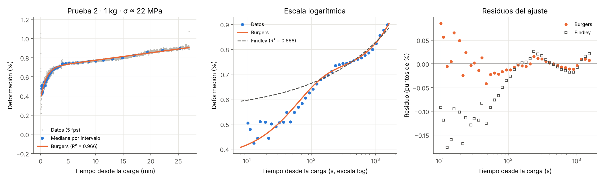

# EcoPlastic: creep de filamento de PET reciclado

Medición de la deformación por fluencia lenta (creep) de filamento de PET reciclado con un teléfono y Python, y ajuste de modelos viscoelásticos. Este código es parte del proyecto EcoPlastic (Equipo STEM).

## Cómo funciona

1. Se cuelga una masa de un tramo de filamento que lleva dos marcas blancas, y se graba en video.
2. `src/seguimiento_marcas.py` localiza las dos marcas en cada cuadro y mide la distancia entre ellas. Precisión de ±0.007 % de deformación.
3. `src/analisis_creep.py` calcula la deformación ε(t) = (L − L0)/L0, ajusta los modelos de Burgers, Findley y Prony, y genera las gráficas.

## Instalación

```
pip install -r requirements.txt
```

## Uso

Seguimiento de un video nuevo. Las coordenadas son la posición aproximada, en píxeles, de cada marca en el primer cuadro:

```
python src/seguimiento_marcas.py video.mp4 datos/pruebaN/seguimiento_crudo_px.csv x_sup y_sup x_inf y_inf
```

Análisis y gráficas (se guardan en `resultados/`):

```
python src/analisis_creep.py
```

`src/escala_regla.py` mide los píxeles por mm de la regla a lo largo del video, para detectar cambios de enfoque del teléfono.

## Resultados hasta ahora

| Prueba | Carga | Esfuerzo | Deformación final | Notas |
|---|---|---|---|---|
| 2 | 1 kg | 22 MPa | 0.91 % a los 27 min | Burgers: R² = 0.966 |
| 3 | 4 → 4.5 kg | 89 → 100 MPa | 14.1 % | Cedencia retardada; ruptura en el nudo a los 20 min |




## Pendiente

- Cálculo de cristalinidad por densidad (Arquímedes, modelo de dos fases).
- Validación cruzada entre condiciones de estiramiento (control, media y alta).
