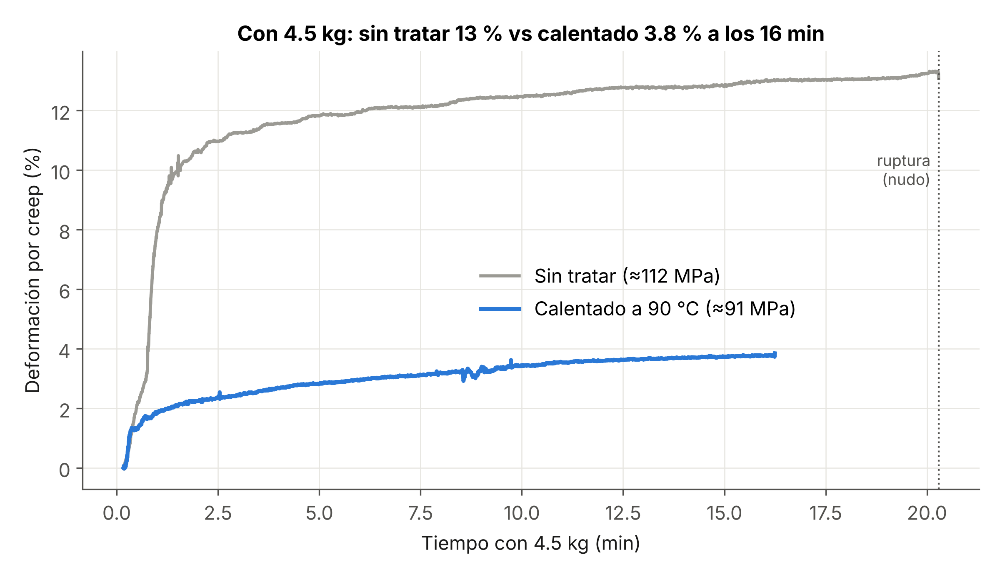
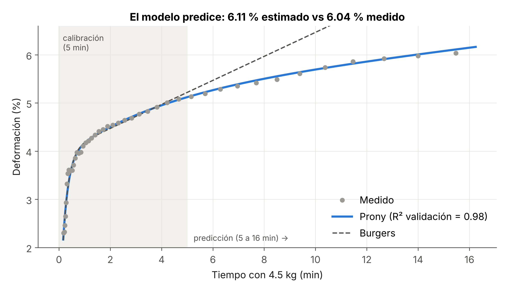
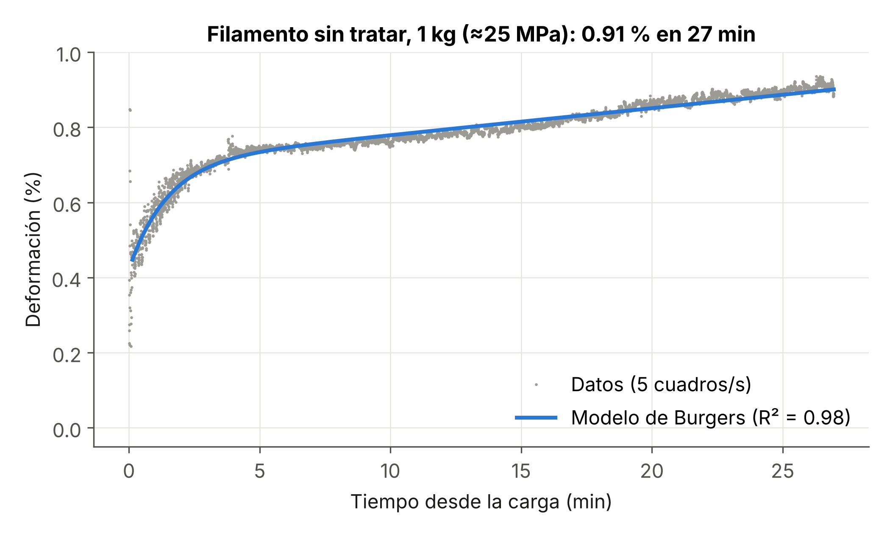

# EcoPlastic: creep de filamento de PET reciclado

Medición de la deformación por fluencia lenta (creep) de filamento de PET reciclado con un teléfono y Python, y ajuste de modelos viscoelásticos. Este código es parte del proyecto EcoPlastic (Equipo STEM).

## Cómo funciona

1. Se cuelga una masa de un tramo de filamento que lleva dos marcas blancas, y se graba en video.
2. `src/seguimiento_marcas.py` localiza las dos marcas en cada cuadro y mide la distancia entre ellas. Precisión de ±0.007 % de deformación.
3. `src/analisis_creep.py` calcula la deformación ε(t) = (L − L0)/L0, ajusta los modelos de Burgers, Findley y Prony, y genera las gráficas.

## Instalación

```
pip install -r requirements.txt
```

## Uso

Seguimiento de un video nuevo. Las coordenadas son la posición aproximada, en píxeles, de cada marca en el primer cuadro:

```
python src/seguimiento_marcas.py video.mp4 datos/pruebaN/seguimiento_crudo_px.csv x_sup y_sup x_inf y_inf
```

Análisis y gráficas (se guardan en `resultados/`):

```
python src/analisis_creep.py     # pruebas 2 y 3 (filamento sin tratar)
python src/analisis_calor.py     # filamento calentado a 90 °C vs sin tratar (4.5 kg) y modelo de Prony
```

`src/escala_regla.py` mide los píxeles por mm de la regla a lo largo del video, para detectar cambios de enfoque del teléfono.

## Resultados hasta ahora

| Prueba | Carga | Esfuerzo | Deformación final | Notas |
|---|---|---|---|---|
| 2 | 1 kg | ≈ 25 MPa | 0.91 % a los 27 min | Burgers: R² = 0.98 |
| 3 | 4 → 4.5 kg | ≈ 100 → 112 MPa | 14.1 % (desde el estado con 4 kg) | Cedencia retardada; ruptura en el nudo a los 20 min |
| 3 con calor | 1 → 4.5 kg | ≈ 20 → 91 MPa | 6.1 % (creep de 3.8 %) a los 16 min | Calentado y estirado a 90 °C; sin cedencia ni ruptura |
| 4 extra | hasta 4.5 kg | ≈ 91 MPa | — | Calentado; ruptura en el nudo a los ~10 s de completar 4.5 kg |

Los números de esta tabla son los finales y salen de `src/figuras_finales.py` (ver `resultados/finales/`). `src/analisis_creep.py` es un análisis anterior que usa el área del vernier y otro ajuste, por eso para la prueba 2 da 22 MPa y R² = 0.966.

Los esfuerzos usan el área calculada con la masa por unidad de largo (densidad supuesta de 1.335 g/cm³), porque es más confiable que el vernier en un filamento que no es perfectamente circular.

**Modelo:** en el filamento calentado, una serie de Prony de 2 términos con flujo, ajustada solo con los primeros 5 min, predice los minutos 5 a 16 con R² = 0.98 (6.11 % predicho contra 6.04 % medido). El modelo de Burgers sobreestima esa misma predicción.







## Limitaciones

- El filamento calentado es más grueso (6.46 mg/cm contra 5.25 mg/cm), así que con 4.5 kg trabajó a menos esfuerzo (≈ 91 contra ≈ 112 MPa).
- El filamento sin tratar ya había cargado 1 kg en la prueba 2.
- El estirado fue pequeño: el largo pasó de 19 a 19.5 cm (λ ≈ 1.03).
- Las rupturas ocurrieron en el nudo, no entre las marcas.

## Pendiente

- Cálculo de cristalinidad por densidad (Arquímedes, modelo de dos fases).
- Ensayos con estiramientos mayores (λ = 2 y 3) a la misma carga y validación cruzada entre condiciones.

## Resultados finales para el reporte y el póster

`resultados/finales/` contiene las 6 figuras finales (300 dpi), las tablas resumen y todos los números en `resultados_completos.json`. Se regeneran con:

```
VIDEO_CALOR="ruta/al/video_prueba3_calor.mp4" python src/figuras_finales.py
```

Sin `VIDEO_CALOR` se generan todas las figuras menos la 1 (foto del montaje). Los textos base del reporte están en `docs/textos_base_reporte_y_poster.md`.
